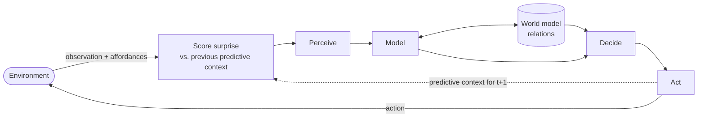

# Architecture

This document describes the design of a single Amoeba cell and the tech stack it builds on. It records the decisions made so far; the code in `src/amoeba/` is still a scaffold.

## Design principles

1. **The cell knows nothing outside its interface.** Following Hoffman's interface theory of perception, a cell never sees the world directly. It sees observations, and it builds a model that lets it predict and act on them. That model is the cell's interface, its memory and its identity.
2. **The world model is relational.** Entities have no intrinsic properties; everything a cell knows is a relation between entities.
3. **Prediction is the learning signal.** A model is good to the degree that it makes the next observation less surprising, measured with a language model's token probabilities.
4. **Keep the cell small.** The whole loop lives in one file, `agent.py`, with no web dependencies.
5. **Separate what is inherited from what is lived.** The genome (heritable configuration) and the soma (lifetime state) are kept apart so that evolution and learning can be studied separately.

## The PMDA loop

Each step runs four stages. The environment drives the loop: it pushes an observation and receives one action back.



| Stage | Input | Output |
|---|---|---|
| **Perceive** | observation text, affordances, aliases of nearby known entities | percept: entity mentions resolved to entity ids (or new ids), salient facts |
| **Model** | percept, k-hop neighborhood of the percept's entities, surprise report | relation operations: `ASSERT`, `REINFORCE`, `WEAKEN`, `RETRACT` |
| **Decide** | percept, updated neighborhood | intent (what to do and why) |
| **Act** | intent, affordances | one concrete action, plus the predictive context kept for the next step |

Act may choose an internal "thought" action that loops back into Perceive without touching the environment.

## Surprise and the learning signal

After each step the cell keeps its **predictive context**: the rendered world-model slice W, the recent history and the action taken. When the next observation `o` arrives, a scorer computes, by teacher forcing:

- **Surprise** `S = −log p(o | history, W)`, in bits per content token.
- **Baseline** `S_base = −log p(o | history)`, without the world model.
- **Model value** `ΔS = S_base − S`: bits the world model saved.
- **Excess bits** `S − H_true`, when the environment exposes the true entropy of its observations (the petri dish does). This is the headline learning metric.

Scoring is a prefill pass with no generation. Only content tokens are scored; template tokens are masked. Token losses can be **weighted by relevance** (e.g. energy-related tokens count more), with the weights held in the genome, so a cell's interface tracks what matters for survival rather than everything.

Surprise gates what the Model stage does:

| Regime | Meaning | Action |
|---|---|---|
| High S, ΔS ≈ 0 | the model has nothing here | **learn**: propose new relations |
| High S, ΔS < 0 | the model is misleading | **revise**: weaken or retract relations in context |
| Low S, ΔS > 0 | the model is earning its keep | **knowledge**: reinforce, raise confidence, accumulate credit |
| Low S, ΔS ≈ 0 | the base model already knew this | **ignore**: store nothing |

A proposed edit is accepted only if it lowers `Σ NLL(o_i | history, W′) + λ·|W′|` over a short replay window, without raising NLL on a held-out set of older observations. The size penalty λ stops the graph from memorizing observations word for word.

To keep the baseline cheap, the world-model slice is placed after the history in the prompt, so `S_base` reuses the cached history prefix.

## World model

Each cell owns one SQLite file. Two tables:

- **`entity`**: identity only. An id plus a list of aliases used by Perceive to resolve mentions ("alpha0", "Alpha-0", "the other cell") to one node. Types are entities too (`cell`), and the cell itself is the entity `self`.
- **`relation`**: `(id, s, p, o, o_is_literal, weight, confidence, evidence, credit, first_seen, last_seen, provenance)`. Every relation id is also an entity, so relations can be the subject of other relations (`r17 holds_when dark`). This handles conditions, context and later abstraction without schema changes.

Predicates start from a small seed vocabulary (`is_a`, `at`, `near`, `part_of`, `has`, `causes`, `precedes`, `holds_when`) and the Model stage may add new ones. Retrieval for a step is the k-hop neighborhood of the percept's entities, one recursive CTE. Embedding-based retrieval can be added later with `sqlite-vec` in the same file.

A per-cell file makes death, cloning and fission simple file operations.

## Genome and soma

| | Genome (heritable) | Soma (lifetime) |
|---|---|---|
| Contents | expression programs: stage prompts, model routing per stage, parameters (decay, thresholds, λ, relevance weights, curiosity weight, mutation rate) | relation store, replay buffer, surprise history, active program; later a LoRA adapter |
| Changed by | mutation and selection between generations | learning within a lifetime |

The genome holds `programs`, starting with `default`. A cell's state records which program it currently expresses. Colonies will use this for differentiation into cell types.

## Embodiment and API

A launched cell process is the cell's body. The environment owns time, energy and consequences; energy arrives inside observations.

| Endpoint | Purpose |
|---|---|
| `POST /step` | observation + affordances in, action + surprise report out |
| `GET /state` | cell id, step count, genome hash, active program, rolling surprise stats |
| `GET /model?entity=…&hops=…` | read part of the world model |

Signals from neighboring cells arrive as part of the observation, and emitting a signal is an action, so multicellular signaling needs no new endpoints.

Environments can embody a cell two ways:
- **In-process**: import `amoeba.Agent` and call `step()` directly, for fast batch runs.
- **Over HTTP**: launch with `amoeba run` and use `amoeba.client.Client`. This is the path Celluler will use.

## Module boundaries

```
src/amoeba/agent.py    the cell: types, store, scorer protocol, stages, loop, genome. No web imports.
src/amoeba/server.py   FastAPI app hosting one Agent
src/amoeba/client.py   httpx client for a running cell
src/amoeba/cli.py      `amoeba run | step | state | model`; uses server and client only
environments/          separate uv workspace package (amoeba-environments); depends on amoeba-agent
```

`environments/` is its own package so it can move to a separate repository, or hold adapters to third-party environments, without touching the core.

## Tech stack

| Concern | Choice |
|---|---|
| Language | Python 3.11+ |
| Packaging | uv workspace, src layout |
| Types and validation | pydantic v2 |
| API process | FastAPI + uvicorn |
| CLI | click |
| HTTP client | httpx |
| World model | stdlib `sqlite3`; `sqlite-vec` later for embeddings |
| Inference | llama.cpp server (prompt log-probabilities, grammar-constrained JSON); vLLM as an alternative |
| Models | a **base** model as the scorer (better calibrated than instruct models); small instruct models for Perceive, Model, Decide and Act. Candidates: LFM2.5-350M, LFM2/LFM2.5 1–3B, Qwen3.5-0.8B, Gemma 3 1B / Gemma 4 E4B |
| Orchestration | a plain async loop; pydantic-graph's builder API only if fork/join becomes useful |

Model choice per stage lives in the genome, so routing can be tuned by evolution.

## Future directions

- **Colonies over Celluler**: cell-to-cell transport over Pear/Holepunch, relation exchange, consensus on a shared interface.
- **Weights**: per-cell or per-type LoRA adapters, distilled from long-confirmed relations during "sleep", then trained encoders and decoders for the stages.
